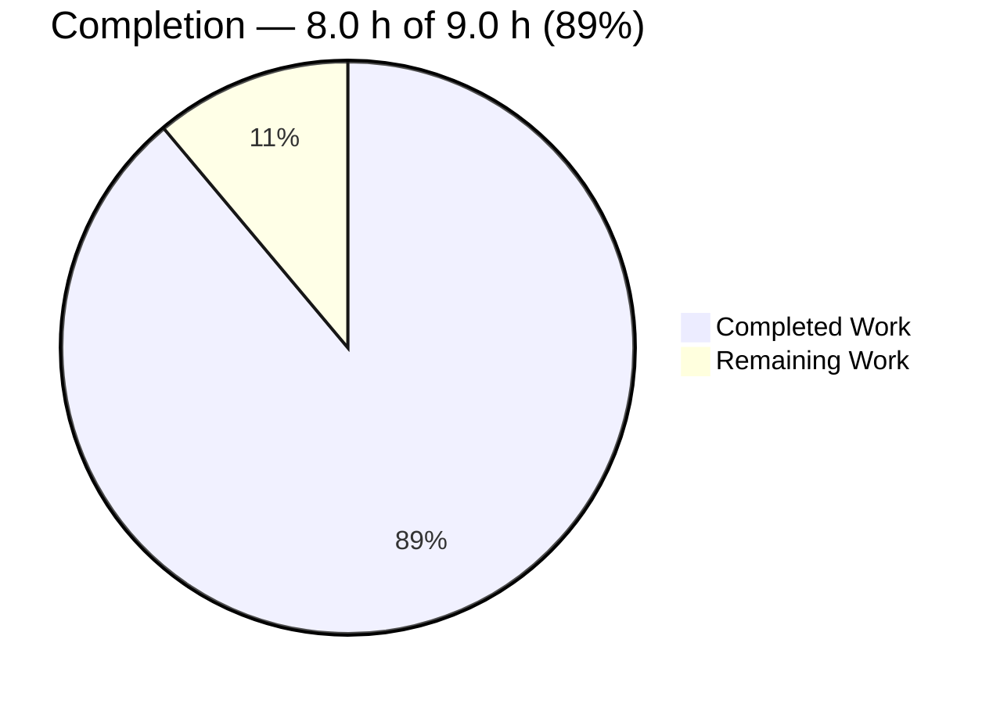
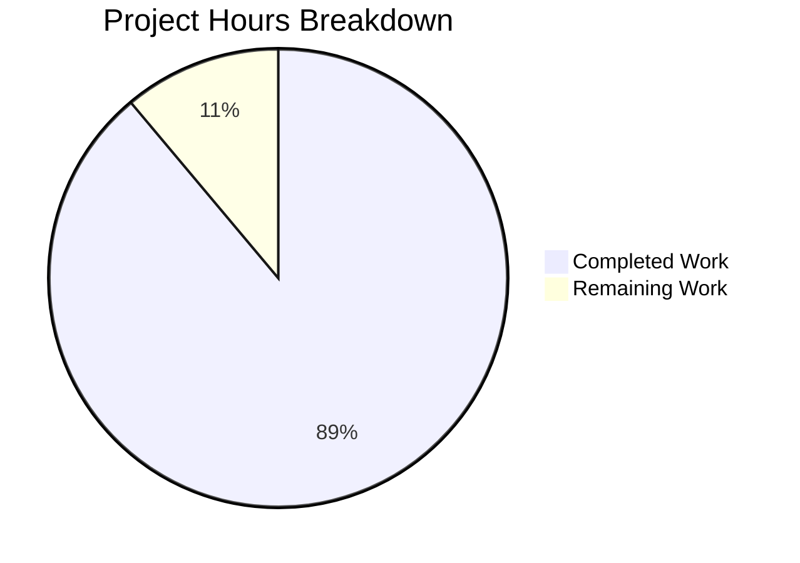

# 1. Executive Summary

## 1.1 Project Overview

The project delivers one command-line program that writes a single line — `Welcome to Blitzy` — to standard output, plus the short document explaining how to run it. It gives the repository the smallest useful Node.js entry point: from the repository root, `node index.js` prints that exact plain-text line, once, and nothing else. Its audience is anyone at a shell prompt who wants a recognisable greeting, and the reviewer who reads two source lines and three README lines. The scope is deliberately minimal: no framework, build step, configuration, dependency, state, network or file access.

## 1.2 Completion Status

All eleven scoped requirements (F1–F6, N1–N5) are delivered and verified; the outstanding hour is release-side confirmation, not unbuilt functionality.

| Metric | Hours |
|--------|-------|
| Total Project Hours | 9.0 |
| Completed Hours (AI + Manual) | 8.0 |
| Remaining Hours | 1.0 |



Calculation: 8.0 completed ÷ (8.0 completed + 1.0 remaining) = **88.9%, stated as 89% complete**.

## 1.3 Key Accomplishments

- ✅ `index.js` writes exactly one line, `Welcome to Blitzy`, to standard output — 18 bytes, no colour, quoting, label or envelope.
- ✅ Two source lines only: one JSDoc summary and one statement.
- ✅ Zero dependencies and no install step: the single call is the runtime's built-in `console.log`.
- ✅ Deterministic and inert — identical bytes across repeated, concurrent, argument-bearing, stdin-closed, scrubbed-environment and forced-colour invocations.
- ✅ No side effects: no socket, no file written, no secret, no configuration read.
- ✅ Install-and-run documentation in three lines, inside the five-line cap (`README.md`).
- ✅ Both published gates green: the parse-and-run gate and the whole-package byte gate.
- ✅ The declared scope held exactly: two root files, with no test, lockfile, dependency, CI, handler or extra directory.

## 1.4 Critical Unresolved Issues

No requirement is left open: 11 of 11 scoped requirements are delivered and verified, so **0 of 11 are open**. Three accepted items carry forward, and none blocks release.

| Issue | Impact | Owner | ETA |
|-------|--------|-------|-----|
| No automated regression gate exists for either file (no test, lint, type or CI gate, by design) | Future edits to the two files rest on review plus the parse and byte gates rather than on an automated suite | Maintainer | On the next change (no hours owed until then) |
| A failed stdout write is silent — exit 0 with empty stderr | Exit status alone does not prove the line reached a consumer on an unwritable or closed stream | Maintainer | Not scheduled; the only remedy is the hardening the constraints forbid |
| Portability is confirmed on one installed runtime only | The "any Node.js runtime providing `console.log`" limb rests on the code's content: one built-in call, no version pinned | Maintainer | With the 0.5 h target-runtime confirmation in 1.6 |

## 1.5 Access Issues

No access issues identified. The program reads no credential or configuration, binds no port and calls no external service, so nothing gates its build, run or deployment.

## 1.6 Recommended Next Steps

1. [Medium] Run the documented command in the target environment and sign off the accepted content — 0.5 h.
2. [Low] Confirm the same 18-byte line on the Node.js release your deployment target provides — 0.5 h.
3. [Low] Keep the parse gate and the whole-package byte gate in the change process: they are the project's only automated protection.
4. [Low] Decide at the next constraint review whether a test file and a lint gate should be permitted; today they are deliberately absent.

# 2. Project Hours Breakdown

## 2.1 Completed Work Detail

| Component | Hours | Description |
|-----------|-------|-------------|
| `index.js` — the greeting program (F1–F5, N1–N5) | 1.5 | Two lines: the one-line JSDoc summary and `console.log("Welcome to Blitzy");`. Settles the exact string and its plain, unquoted output, the two-line minimum, the single-line JSDoc form, and zero dependency, build step or state. |
| `README.md` — install-and-run documentation (F6) | 0.5 | Three lines: the title, and one line carrying the install fact (no dependencies, Node.js required) and the run command, inside the five-line cap with no forbidden section. |
| Acceptance verification of the delivered pair (F1–F3, F5, F6) | 3.0 | Byte-identity of each file against the accepted content, the parse gate, the documented run, stdout byte and hex fidelity including the trailing-newline boundary, stream separation, the whole-package `od -c` and `cmp -` gates, and the README line-cap and heading gates. |
| Runtime characterisation of the program (F2, N1–N4) | 3.0 | Determinism at scale (20 sequential and 10 concurrent runs), inertness across invocation forms (argv, `--help`, closed and piped stdin, scrubbed environment, hostile locale with forced colour, foreign working directory, TTY, unwritable and closed stdout, mid-stream reader close), dependency and absence sweeps, socket and tree-integrity checks. |
| **Total** | **8.0** | |

## 2.2 Remaining Work Detail

| Category | Hours | Priority |
|----------|-------|----------|
| Independent acceptance sign-off on the delivered pair — re-run the documented command in the target environment and confirm the accepted content | 0.5 | Medium |
| Portability confirmation on the Node.js release your deployment target provides (the "any runtime" limb of N3 was confirmed on the one installed runtime) | 0.5 | Low |
| **Total** | **1.0** | |

Completed 8.0 h + remaining 1.0 h = 9.0 total project hours, as stated in 1.2. Nothing outside the plan's scope is counted: test suites, linters, packaging metadata and stdout error handling are excluded by the request's own constraints, so they appear as decisions, never as remaining work.

# 3. Test Results

The project ships no test framework and none may be added — the request's binding constraints forbid a test suite, test files, a lockfile and any dependency — so the suite below is an acceptance battery of byte-level and behavioural assertions executed against the delivered files. Every count is one observed in this assessment; 81 checks were executed, 81 passed, 0 failed.

| Area / Category | Framework | Tests | Passed | Failed | Coverage | What This Proves |
|-----------------|-----------|-------|--------|--------|----------|------------------|
| Parse gate and documented run | Node.js runtime | 5 | 5 | 0 | n/a | `index.js` parses, and `node index.js` exits 0 with one line on stdout and nothing on stderr |
| Output byte fidelity and plainness | Node.js + POSIX shell | 5 | 5 | 0 | n/a | stdout is exactly the 18 bytes `Welcome to Blitzy\n` — one line, no escape byte, no quotes, label or envelope |
| Whole-package byte gate (`od -c`, `cmp -`) | POSIX shell | 3 | 3 | 0 | n/a | The stream a pipeline consumer receives is byte-for-byte the required line |
| Invocation-form inertness | Node.js + POSIX shell | 35 | 35 | 0 | n/a | Arguments, stdin, environment, locale, colour settings, working directory, terminal type and stream failures never change the output |
| Determinism and concurrency | Node.js + POSIX shell | 6 | 6 | 0 | n/a | Sequential and concurrent runs all produce the one identical line |
| Static form and documentation gates | POSIX shell | 16 | 16 | 0 | n/a | The two-line program, its tag-free single-line JSDoc summary and the three-line README all hold as specified |
| Exclusion and absence sweeps | POSIX shell + git | 6 | 6 | 0 | n/a | No manifest, lockfile, dependency, test file, CI or extra artifact exists; the tracked set is exactly two paths |
| Side effects and tree integrity | POSIX shell + git | 5 | 5 | 0 | n/a | No socket is opened, no file is written and the working tree is unchanged after every run |

Coverage is marked n/a because a zero-dependency project has no coverage tooling to bind: each check is an assertion on bytes, exit status or tree state rather than an instrumented line count.

**Not Covered**

- **No automated regression gate.** There is no test framework, suite or runner anywhere in the project — deliberately, under the request's constraints — so every check above was executed directly rather than by a suite. Before release, a human should treat the parse gate and the whole-package byte gate as the standing protection for these two files.
- **Runtimes other than the installed one.** The "any JavaScript runtime providing `console.log`" limb of N3 was confirmed on the single installed Node.js v22.23.4 only. Before release on a different runtime, run the documented command once there and confirm the same 18-byte line.
- **Non-POSIX hosts.** The program was exercised through a POSIX shell, pipes, redirection and a pseudo-terminal. Console encoding, line-ending and shell behaviour on another platform family were not exercised; a human should run the documented command once on any such target.
- **Performance.** N5 sets no latency, throughput or concurrency obligation, so no load, latency or memory measurement was made and none is owed.

# 4. Runtime Validation & UI Verification

- ✅ **Clean start** — `node index.js` from the repository root: exit 0, one 18-byte line on stdout, nothing on stderr.
- ✅ **Documented invocation** — the command named in `README.md:3` run verbatim, with no install step: same result.
- ✅ **Stream separation** — stderr stays at 0 bytes in every invocation form, including when it is merged into a non-terminal stream.
- ✅ **Determinism** — 20 sequential and 10 concurrent invocations produced one unique result, byte-identical to the required line.
- ✅ **Invocation breadth** — spare arguments, `--help`, closed and piped stdin, a scrubbed environment, a hostile locale with forced colour, a foreign working directory, an absolute-path invocation and a pseudo-terminal all produced identical bytes.
- ✅ **Byte-level plainness on a terminal** — the pseudo-terminal transcript carries the line with zero escape bytes; its carriage return is the terminal's own line discipline.
- ⚠ **Partial — failed stdout write** — an unwritable (`>/dev/full`) or closed (`>&-`) stdout exits 0 with empty stderr: the write failure is silent, inherited from the mandated `console.log`, so exit status alone does not prove the line reached a consumer.
- ✅ **Absence of side effects** — 0 listening TCP sockets, no file written, no state or temporary file, and the working tree unchanged after every run.
- ✅ **No browser surface exists to drive** — no HTML, no server, no bound port and no rendered design; there is no screen, page or UI flow to verify.

**Never exercised at runtime:** any runtime other than the installed Node.js v22.23.4, and any non-POSIX host. Every other surface a production system would carry is absent from this deliverable rather than untested — it has no HTTP endpoint, no database or store, no message broker, no configuration source, no logging or metrics, no authentication flow and no external integration to drive, so nothing of that kind was checked or could have been.

# 5. Compliance & Quality Review

## 5.1 Compliance Matrix

| Deliverable / Benchmark | Status | Progress | Evidence |
|-------------------------|--------|----------|----------|
| `index.js` — required output (F1, F2) | ✅ PASS | Complete | stdout is exactly 18 bytes, one line, plain, byte-identical to the required payload; no escape byte, quoting, label or envelope |
| `index.js` — form, size and comment (F3, F5) | ✅ PASS | Complete | 2 lines / 85 bytes; one tag-free single-line JSDoc summary; one top-level statement; 0 branches, functions, classes or imports |
| `README.md` — content and cap (F6) | ✅ PASS | Complete | 3 lines / 66 bytes, one H1, the install fact and the run command, no contributing/license/testing/deployment/architecture/TOC section |
| Acceptance criterion — both files | ✅ PASS | Complete | Each file compares byte-identical to the accepted content (`index.js` 85 = 50 + LF + 33 + LF; `README.md` 66 bytes) |
| Zero dependencies and no install step (N1) | ✅ PASS | Complete | No manifest, lockfile or `node_modules` anywhere; 0 imports; the sole call is the runtime built-in `console.log` |
| Determinism and isolation (N2) | ✅ PASS | Complete | 20 sequential and 10 concurrent runs produced one unique result; inert to arguments, stdin, environment, locale, colour settings and working directory |
| Portability and no build step (N3) | ✅ PASS | Complete, with a caveat | Parse gate exit 0; direct interpretation; no build, lint or type configuration and no generated artifact; no version pinned. Confirmed on the one installed runtime (v22.23.4) |
| Security review (N4) | ✅ PASS | Complete | No input channel, socket, file access, evaluation of user data, secret or third-party code; every injected adversarial payload was inert |
| Scope discipline — two root files, nothing else | ✅ PASS | Complete | Tracked set is `index.js` and `README.md`; 34 excluded artifact names checked, none present; no rename or delete |
| Minimal diff and no unrelated change (F4, c1) | ✅ PASS | Complete | 2 files, 5 insertions, 2 deletions against the baseline commit; nothing outside the two paths touched |
| Automated quality gates | ⚪ N/A by constraint | Not applicable | No test, lint, format, type or CI gate exists, because the request's constraints forbid adding one; the parse gate and the whole-package byte gate are the only automated protection |

The twelve constraints the request set all hold: the six that bind the delivered tree (smallest diff, no other file, one-line JSDoc, README under the cap, no test/lockfile/dependency, no handler or unrequested hardening) on the tree itself, and the six that bind the plan document having no subject in it.

## 5.2 AAP & Rule Divergences and Gaps

| What the AAP/Rule Required | What Was Delivered Instead | Why It Diverged | Impact | Remediation |
|----------------------------|----------------------------|-----------------|--------|-------------|
| `README.md` added as a new file — "Both paths are additions, and no existing file is modified" | The accepted three-line content replaced, in place, a two-line placeholder already tracked at that path (`README.md:1-3`) | The path already existed holding generated placeholder text, and the accepted content governs, so the same bytes landed at the same path; recorded as a settled decision, not a defect | None on behaviour, content or size — the file matches the accepted content byte for byte | None. A plan regenerated for this repository should describe the path as pre-existing |
| Platform validation expectations for source work: ad-hoc tests, a module test suite, a lockfile, and a linter run with `--no-fix` on each modified file | No test file, suite, lockfile or lint gate was created or run; in their place, byte-identity assertions, the parse gate and the whole-package byte gate | The request's binding constraint list forbids a test suite, test files, a lockfile and any dependency; no linter is installed, and adding one would create the forbidden dependency | The project has no automated regression gate, so future edits rest on review plus the two byte-level gates | None within this scope. Permitting a test file and a lint config would cost about 2 h |
| Conventionally, a command-line program signals a failed write through its exit status | An unwritable or closed stdout exits 0 with empty stderr: the write failure is silent (`index.js:2`) | Inherited from `console.log`, the exact construct the accepted content mandates; the only remedy is an error handler the constraint list forbids | Exit status alone does not prove the line reached a consumer — the greeting can be dropped silently on a closed or full stream | Accepted with the caveat in 1.4 and 6. Closable only by permitting stdout error handling (about 1.5 h) |
| Plan figures for the delivered state: an empty checkout, `index.js` at 82 bytes, runtime Node.js v22.23.3 | The path held a two-line placeholder before the change; `index.js` is 85 bytes (50 + LF + 33 + LF); the installed runtime is Node.js v22.23.4 | The figures were recorded when the change was planned and not re-measured; the accepted criterion is the stated content, which both files match byte for byte, and the patch level is a host fact | None on the artifact: no byte count and no version appears anywhere in the deliverable | None on the code. Carry the measured figures in any regenerated plan |

**The `README.md` delivery route.** The plan describes both deliverable paths as additions to an empty checkout, and `README.md` arrived differently: a two-line generated placeholder already sat at that path, and the accepted three-line content replaced it in place. The cause is the pre-existing path together with the accepted content governing — the same bytes had to land where the placeholder stood — and the route was recorded as a settled decision rather than as a defect. Impact is nil for anyone reading the code: `README.md:1-3` matches the accepted content byte for byte and no placeholder text survives. No action is required; a plan regenerated for this repository should describe this path as pre-existing.

**Test, lockfile and linter expectations.** The request's constraint list forbids a test suite, test files, a lockfile and any dependency, and no linter is installed or installable without adding one. Delivering no test artifact therefore departs from the platform's usual validation expectations for source work, deliberately: the user's constraints outrank those defaults. In their place stand byte-identity verification of both files against the accepted content, the parse gate (`node --check index.js`) and the whole-package byte gate. The impact is that a future edit to `index.js` or `README.md` has no automated suite behind it. Closing that gap is a decision rather than outstanding work — permitting a test file and a lint configuration would cost about 2 h.

**Plan figures that do not match the tree.** Two recorded figures do not describe the repository as delivered: the checkout was not empty when the change was written (a two-line placeholder `README.md` was already tracked), and `index.js` measures 85 bytes rather than the 82 recorded — 50 + LF + 33 + LF, matching the accepted content exactly. The installed runtime is Node.js v22.23.4 where the plan says v22.23.3. Content, not arithmetic, is the accepted criterion, and neither a byte count nor a version string appears anywhere in the deliverable, so the impact is limited to a reader comparing the plan with the disk. No code action follows; a regenerated plan should carry the measured figures.

**Silent write failure.** A command-line program conventionally signals a failed write through its exit status. Here, writing the greeting to an unwritable or closed stdout exits 0 with empty stderr, so the line can be dropped without any signal. That behaviour is inherited from `console.log`, the exact construct the accepted content mandates (`index.js:2`), and the only remedy — an explicit stdout error handler — is hardening the constraint list forbids. The impact is operational and small: a pipeline or wrapper cannot infer from the exit status that the line reached it. It is accepted with the caveat recorded in 1.4 and 6, and can be closed only by permitting error handling (about 1.5 h).

No other divergences from the AAP or the user's constraints were identified: all eleven scoped requirements are delivered as written, and all twelve constraints hold.

# 6. Risk Assessment

| Risk | Category | Severity | Probability | Mitigation | Status |
|------|----------|----------|-------------|------------|--------|
| Future edits to either file are unprotected — no test, lint, format, type or CI gate exists | Technical | Medium | High | Keep the parse gate and the whole-package byte gate in the change process for these two files; add a test file and a lint configuration only if the request's constraints are relaxed | Accepted by design |
| Portability is unproven beyond one runtime | Integration | Low | Low | The code's only API call is the built-in `console.log` and no version is pinned, so risk rests on availability of that built-in; run the documented command once on the target release | Open — 0.5 h |
| A failed stdout write is silent, so a wrapper cannot detect a dropped greeting | Operational | Low | Low | Treat the greeting as best-effort output and do not infer delivery from exit status alone; add stdout error handling only if hardening is permitted | Accepted with caveat |
| No Node.js version floor is stated anywhere | Operational | Low | Low | Any current Node.js release supplies `console.log`; if distribution ever requires a floor, state it wherever the invocation is documented | Accepted by design |
| No packaging metadata — no manifest, no script or bin entry | Operational | Low | Low | Distribute and run by the documented invocation, `node index.js` from the repository root | Accepted by design |
| Non-POSIX host behaviour is unverified — console encoding, line endings and shell differences | Integration | Low | Low | Run the documented command once on any non-POSIX target and confirm the same 18-byte line before release there | Open — covered by the acceptance sign-off |
| Security exposure from the program itself | Security | Negligible | Negligible | No input channel, socket, file access, evaluation of user data, secret or third-party code exists, so no control is owed or present | No exposure identified |

# 7. Visual Project Status

The charts below restate the hours from 1.2 and 2.2. Completed work is shown in Blitzy dark blue, remaining work in white.



**Completion: 89%** — 8.0 of 9.0 hours delivered and verified; 1.0 hour remains, both halves of it release-side.

| Remaining category | Hours | Priority |
|--------------------|-------|----------|
| Independent acceptance sign-off on the delivered pair | 0.5 | Medium |
| Portability confirmation on the target Node.js release | 0.5 | Low |
| **Total** | **1.0** | |

# 8. Summary & Recommendations

**What was delivered.** The project is two files at the repository root: `index.js`, which writes the single plain-text line `Welcome to Blitzy` to standard output, and `README.md`, which states that there is nothing to install and how to run it. All eleven scoped requirements are delivered as written — the exact string, plain and unformatted; the two-line file with its single-line JSDoc summary; a README inside the five-line cap; zero dependencies and no install step; deterministic output; direct interpretation with no build step; no security surface; and no performance obligation. The change is additive and minimal: 2 files, 5 insertions, 2 deletions, nothing else touched.

**What was exercised to prove it.** 81 acceptance checks were executed directly against the delivered files — the project ships no test framework and the request's constraints forbid adding one — covering the parse gate, the documented run, stdout byte and hex fidelity including the trailing-newline boundary, stream separation, the whole-package `od -c` and `cmp -` gates, determinism across 20 sequential and 10 concurrent runs, inertness across arguments, stdin, a scrubbed environment, a hostile locale with forced colour, a foreign working directory, an absolute-path invocation and a pseudo-terminal, absence sweeps for every excluded artifact, and socket and tree-integrity checks. All 81 pass: stdout is byte-for-byte the required 18-byte line, stderr stays empty, no socket opens, no file is written and the working tree is unchanged.

**What remains, and the critical path.** Completion is 89% — 8.0 of 9.0 hours delivered, with 1.0 hour outstanding, both release-side. The critical path to production is short and has two steps: run the documented command in the target environment and sign off the accepted content (0.5 h), then confirm the same 18-byte line on the Node.js release that target provides (0.5 h). Nothing else blocks release. Three accepted items carry forward without blocking: no automated regression gate exists for the two files, a failed stdout write is silent, and portability has been confirmed on one installed runtime only.

| Success metric | Result |
|----------------|--------|
| Scoped requirements delivered | 11 of 11 |
| Acceptance checks passed | 81 of 81 |
| Deliverable files present | 2 of 2 |
| Excluded artifacts present (34 names checked) | 0 |
| Declared dependencies | 0 |
| Scoped hours delivered | 8.0 of 9.0 (89%) |

**Production readiness.** Ready for its stated purpose: a minimal, dependency-free, single-file command-line program. Its documented command needs no install, no build, no configuration, no environment value, no secret and no service; it is byte-deterministic under every invocation form exercised, opens no socket, touches no file and carries no secret. The capabilities a larger service would carry — tests, lint and type gates, CI, packaging metadata, error handling on a failed stdout write, a version floor — are absent because the request's constraints forbid them, not by omission, and they are recorded in 1.4, 2.2, 5.2 and 6 as decisions and accepted caveats rather than as unfinished work.

**Recommendation.** Accept the deliverable, complete the two release-side steps above, and keep the parse gate and the whole-package byte gate in the change process for these files: with no test suite by design, they are what stands between a future edit and a silent change in the line the program prints.

# 9. Development Guide

## 9.1 System Prerequisites

- **Node.js** — the runtime that executes the file. v22.23.4 is installed here (`node --version` → `v22.23.4`). Any release that provides the built-in `console.log` runs the program, and no version floor is asserted anywhere in the repository.
- **A POSIX shell** (`bash`, `sh`) for the verification commands below. They use only standard tools: `node`, `printf`, `cmp`, `od`, `wc`.
- **Nothing else.** No package manager, compiler, transpiler, bundler, database, broker or container is needed. Git is required only to obtain the repository.

## 9.2 Environment Setup

- No installation step exists. The program imports nothing and declares no package, so there is no manifest, lockfile or dependency to install, and no build stage precedes execution.
- No configuration is required: no environment variable, secret or configuration file is read, and the program behaves identically under a scrubbed environment.
- Do not run `npm install`, `npm test` or `npm run build`. With no manifest they fail with `npm error code ENOENT … package.json`, and that absence is deliberate.
- Run every command below from the repository root, which is the directory holding `index.js` and `README.md`.

## 9.3 Repository Layout

| Path | Purpose |
|------|---------|
| `index.js` | The whole program: one JSDoc summary line and `console.log("Welcome to Blitzy");` |
| `README.md` | Install and run: three lines, stating no dependencies, that Node.js is required, and the run command |

Nothing else is tracked: there is no source directory, test directory, configuration file or build output.

## 9.4 Dependency Installation

None required. The program's only call is `console.log`, a built-in of the Node.js runtime, so there is nothing to fetch, lock or install. Adding a manifest, lockfile or dependency would change the deliverable and is expressly out of scope for it.

## 9.5 Application Startup

```bash
# From the repository root:
node index.js
```

Expected: exactly one line on stdout —

```text
Welcome to Blitzy
```

— with nothing on stderr and exit status 0. From any other directory, invoke the file by its full path instead:

```bash
node "<absolute path to index.js>"
```

A relative path from another directory does not work: Node.js then fails with `Error: Cannot find module … MODULE_NOT_FOUND`.

## 9.6 Verification Steps

```bash
# 1. Parse gate — no output, exit status 0
node --check index.js

# 2. The per-change gate: parse, then run
node --check index.js && node index.js

# 3. Whole-package byte gate — expect: W e l c o m e   t o   B l i t z y \n  (18 bytes)
node index.js | od -c

# 4. Byte-identity against the required line — no output, exit status 0
cmp <(node index.js) <(printf 'Welcome to Blitzy\n')

# 5. Nothing on stderr — expect 0
node index.js 2>&1 >/dev/null | wc -c

# 6. Documentation gate — expect 3, under the five-line cap
wc -l README.md
```

## 9.7 Example Usage

```bash
# Capture the greeting in a shell variable (nothing is written to the repository)
line=$(node index.js); printf '%s\n' "$line"

# Use it as the first stage of a pipeline
node index.js | cat

# Inspect the exit status
node index.js > /dev/null; echo "exit=$?"
```

If you need a file, redirect to a location outside the repository: writing inside the checkout adds an untracked file to the working tree.

## 9.8 Troubleshooting

| Symptom | Cause | Resolution |
|---------|-------|------------|
| `Error: Cannot find module … code: 'MODULE_NOT_FOUND'` | The command was run from a directory other than the repository root | Run it from the repository root, or pass the full path to `index.js` |
| `npm error code ENOENT … path …/package.json` | An npm command was run on a project that has no manifest, by design | Use `node index.js`; npm commands do not apply here |
| `node: command not found` | Node.js is not on `PATH` | Install or expose a Node.js release, then re-run `node --version` to confirm |
| The greeting is absent but exit status is 0 | Output was written to a closed or full stream, where the write failure is silent | Check the consumer of stdout; delivery cannot be inferred from the exit status alone |
| Output looks one byte longer on a terminal | The terminal's line discipline converts the trailing newline to CRLF | Compare bytes rather than a terminal view: `node index.js | od -c` shows 18 bytes |

# 10. Appendices

## Appendix A — Command Reference

| Command (run from the repository root) | Purpose | Expected result |
|----------------------------------------|---------|-----------------|
| `node --version` | Confirm the runtime | `v22.23.4` |
| `node --check index.js` | Parse gate | No output, exit status 0 |
| `node index.js` | Run the program | `Welcome to Blitzy`, exit status 0, empty stderr |
| `node "<absolute path to index.js>"` | Run from another directory | Same single line |
| `node index.js \| od -c` | Whole-package byte gate | `W e l c o m e   t o   B l i t z y \n` — 18 bytes |
| `cmp <(node index.js) <(printf 'Welcome to Blitzy\n')` | Byte-identity check | No output, exit status 0 |
| `node index.js 2>&1 >/dev/null \| wc -c` | Confirm stderr is empty | `0` |
| `wc -l README.md` | Documentation cap | `3` (under five) |
| `git status --porcelain` | Confirm the run changed nothing | No output |

## Appendix B — Port Reference

No port is bound, in either direction. The program opens no TCP or UDP socket, starts no server and listens on nothing; it has no HTTP or HTTPS endpoint, no database, broker, cache or queue connection, and no outbound network call. `node index.js` completes in milliseconds and exits, leaving no listener or pending handle behind.

## Appendix C — Key File Locations

| Path | Role | Size |
|------|------|------|
| `index.js` | The whole program — one JSDoc summary line and one `console.log` statement | 2 lines / 85 bytes |
| `README.md` | Install and run, in three lines | 3 lines / 66 bytes |

Both sit at the repository root, which is what keeps the documented invocation free of any path prefix. No other file is tracked.

## Appendix D — Technology Versions

| Component | Version / detail |
|-----------|------------------|
| Node.js runtime | v22.23.4 installed; any release providing `console.log` runs the file, and no version is pinned in the repository |
| JavaScript | Plain ECMAScript executed directly by the runtime; no transpiler, bundler, module syntax or build step |
| Verification tooling | Standard POSIX shell utilities (`printf`, `cmp`, `od`, `wc`, `grep`, `find`, `git`) |
| Dependencies | None — no manifest, no lockfile, no `node_modules` |

## Appendix E — Environment Variable Reference

| Variable | Required | Purpose |
|----------|----------|---------|
| — | None | The program reads no environment variable, configuration file or secret |

Running with an emptied environment (`env -i node index.js`) produces byte-identical output, so no variable must be set for development, verification or deployment.

## Appendix F — Developer Tools Guide

- **No code-quality tooling is configured**: no linter, formatter, type checker, test runner or CI configuration exists, because any of them would require a manifest and a dependency the request's constraints forbid.
- **Read-only checks you can run today**: the parse gate (`node --check index.js`), the whole-package byte gate, the byte-identity `cmp` check, and absence sweeps with `grep`/`find` (for example, confirming no manifest, lockfile or test file exists).
- **Editors need no setup**: the file is plain JavaScript with no `tsconfig.json`, ESLint or Prettier configuration, and markdown has no `markdownlint` configuration — so `README.md` form is checked by reading it and by `wc -l`.
- **Before adding any tool**, note that it changes the project's declared shape: any test runner, linter or formatter brings a manifest and a dependency, both currently excluded.

## Appendix G — Glossary

| Term | Meaning |
|------|---------|
| Acceptance criterion | The exact accepted content of the two files: the two-line program and the three-line README |
| Byte-identical | The same bytes in the same order — compared with `cmp` rather than by eye |
| Parse gate | `node --check index.js`: parses the file without executing it; exit status 0 means the file is syntactically valid |
| Whole-package byte gate | `node index.js \| od -c` (or `cmp` against the expected bytes): confirms the exact 18-byte line a consumer receives |
| JSDoc summary line | The single `/** … */` comment line above the statement, with no tags, as the request requires |
| Scrubbed environment | A run with an empty environment (`env -i …`), which produces identical output |
| Terminal line discipline | The terminal layer that turns the trailing newline into CRLF on a pseudo-terminal; the byte stream itself stays 18 bytes |
| Deterministic output | Every run, sequential or concurrent, emits the same single line — the program takes no input and holds no state |
